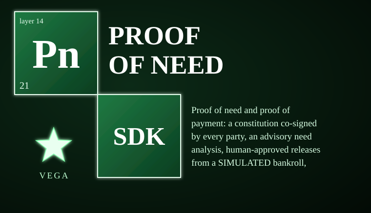

# vega-proof-of-need-sdk



<!-- vega-install-order -->
> **Build order: 5/5. This kit needs 4 other Vega kits installed first.** Install them in this order, then this one:
> 1/5 `vega-custody-sdk`  
> 2/5 `vega-governance-jacket-sdk`  
> 3/5 `vega-identity-sdk`  
> 4/5 `vega-superproof-sdk`  
> 5/5 `vega-proof-of-need-sdk` (this kit)
> Install each with `pip install --no-deps git+https://github.com/jasonblasiak868-code/<name>` in the order shown, plus `pip install cryptography`. Full steps: [INTEGRATION_GUIDE](https://github.com/jasonblasiak868-code/vega-umbrella-sdk/blob/main/INTEGRATION_GUIDE.md).

Proof of need and proof of payment: a constitution co-signed by every party, an advisory need analysis, human-approved releases from a SIMULATED bankroll, institution receipts, disputes, and privacy-preserving proof of income.

> **Licensing.** Source-available, not open source. Free for personal use; free for registered small businesses (under US$1M revenue and valuation); everyone else needs a commercial license (see LICENSE; for a commercial license write to jasonblasiak.ai.mail@gmail.com). Patent pending. Draft licence text, not yet reviewed by an attorney.

## Specifications

| Property | Value |
|---|---|
| Version | 0.1.0 |
| Python | >=3.10 |
| Dependencies | cryptography>=42, vega-custody-sdk, vega-governance-jacket-sdk, vega-superproof-sdk, vega-identity-sdk |
| Tests | 32 tests in 3 files (redteam_1_need.py), all passing |
| Mutation survivors | 4 (decline blocks release, released once, human commitment required, safety net institutions) |
| Status | BUILT: constitution, analysis, book, income. DESIGNED ONLY: freedom experiments, saving/investing mechanic, durable storage, real-money legal structure |

## End-to-end functions

1. **Constitute** — parties draft a constitution (categories, caps, want-signals, safety-net, dispute method); every party signs the exact document hash; only when all signatures are present does it become ACTIVE.
2. **Analyse** — a request (category, amount, payee, purpose, evidence) receives an ADVISORY classification (NEED/WANT/MIXED/UNCLEAR), confidence 0.05–0.95, reasons, and flags (want_signal_in_need, evidence_missing, payee_not_an_institution). A pluggable model analyser is validated and clamped to the same bounds.
3. **Request** — a party submits a signed request; the purpose text stays off-chain (only its hash is recorded); the advisory analysis is attached and recorded.
4. **Approve/Decline** — parties with roles the category requires sign the request ID **and the analysis flags they saw**; the requester cannot approve; any decline blocks release.
5. **Release** — only when every required role has approved, no decline exists, the monthly cap, balance, payee rule, and evidence rule all hold. If a jacket Commit is configured, the device owner's human commitment for `spend_funds` over exactly this request is also required. Burn-then-record: the chain entry is written first, then the simulated balance moves.
5. **Safety-net release** — if the constitution enables it and approvers have not answered for the agreed time (1 hour–30 days), money may go to a REGISTERED INSTITUTION for a listed category up to a maximum, on the standing authority of the co-signed constitution. Any decline blocks it.
6. **Proof of payment** — the institution signs a receipt matching the release's payee and amount; mismatches are recorded as DISCREPANCY and the release stays unpaid.
7. **Dispute/Resolve** — per the constitution: both parties sign, or the named arbiter signs. A reversed decline lets the normal release path proceed.
8. **Prove income** — an issuer (employer, bank) commits to a hidden number with a Pedersen commitment and signs the commitment. The holder proves in zero knowledge that the number is at least a threshold, bound to a context (who, when). The verifier checks the issuer's signature and the proof; the number is never revealed.

## Controls

| Control | What it does |
|---|---|
| `ConstitutionRefused` / `NeedRefused` / `AnalysisRefused` / `IncomeRefused` | Domain exceptions raised on any validation failure; all paths fail closed. |
| `Constitution.Record.active` | True only when every party has a valid signature over this exact document. |
| `Constitution.amend` | Only an ACTIVE constitution can be amended; new version must be `prev.version + 1` and name the previous digest; starts unsigned (every party signs again). |
| `analysis.analyse` | Rule-based advisory classification; confidence clamped to [0.05, 0.95]; want signals in a NEED category produce `want_signal_in_need` flag. |
| `analysis.checked` | Validates and clamps a plugged-in analyser's output; rejects malformed results. |
| `NeedBook.__init__(real_money=False)` | `real_money=True` is refused at construction — no money-transmission licensing, KYC/AML, custody, or COPPA consent are cleared. |
| `NeedBook.deposit` | Signed, fresh nonce, whole cents; replayed nonces rejected. |
| `NeedBook.submit` | Validates category, amount, payee, purpose (3–300 printable chars), evidence (≤10 doc hashes), nonce (8–64 chars), signature over request digest. Duplicate requests rejected. |
| `NeedBook.approve` | Only approving roles other than requester; signature binds request ID **and** the analysis flags hash. |
| `NeedBook.decline` | Only approving roles other than requester; sets state to `declined`. |
| `NeedBook.release` | Requires all approvals, no declines, caps, balance, payee rule, evidence rule. Optional jacket Commit for `spend_funds`. |
| `NeedBook.safety_net_release` | Only for unanswered requests after timeout; institutions only; max cap; any decline blocks. |
| `NeedBook.proof_of_payment` | Receipt must match payee, amount, hash, time, and institution signature; returns `False` on mismatch (records DISCREPANCY). |
| `NeedBook.dispute` / `resolve` | Per constitution method; required signers enforced; reversed decline clears declines for re-release. |
| `income.issue` / `prove_at_least` / `verify_at_least` | Delegates to `vega_superproof.seal.zk` (classical security, not quantum-proof, not independently reviewed). |

## What it CANNOT do

- **NO REAL MONEY**: balances are whole numbers of cents in memory. Moving real money needs money-transmission licensing, KYC/AML, custody, and for children COPPA and consent — none of that is cleared.
- **Not a security review**: this code has not been independently security-reviewed. The automated review and two red-team passes are not proof of safety.
- **Crypto not expert-reviewed**: the Ed25519 and Pedersen/ZK operations use plain Python `cryptography` and `vega-superproof`; do not protect real secrets or financial figures with it before an independent review.
- **Containment is process-level, not an OS sandbox**: the model runs in the same process; a compromised process can bypass gates.
- **License matrix is policy, not legal advice**: the licence is a draft not yet reviewed by an attorney.
- **A minor's signature is an assent, not legal consent**: who may sign for whom is a legal question this code does not answer.
- **Income proof shows a number is in range; whether it is TRUE is the issuer's word**: the proof does not verify the underlying fact.
- **Durable storage not built**: state lives in memory; a real system needs durable storage and the legal structure above.
- **Freedom experiments and saving/investing mechanic are DESIGNED ONLY**: they would collect children's behaviour data (needs consent/privacy model first) or enter securities territory.
- **Mutation testing survivors**: 4 mutations survived (decline blocks release, released once, human commitment required, safety net institutions) — see mutation report.

## Platform support

| Capability | Support |
|---|---|
| Pure Python logic (constitution, analysis, book, income) | Runs anywhere CPython 3.10+ runs: Windows, macOS, Linux. |
| Ed25519 signatures (`cryptography` library) | Runs anywhere CPython 3.10+ runs: Windows, macOS, Linux. |
| Pedersen commitments / ZK proofs (`vega-superproof`) | Runs anywhere CPython 3.10+ runs: Windows, macOS, Linux. |
| DAG/ledger (`vega-custody-sdk`) | Runs anywhere CPython 3.10+ runs: Windows, macOS, Linux. |
| Human commitment (`vega-governance-jacket-sdk`) | Runs anywhere CPython 3.10+ runs: Windows, macOS, Linux. |
| Mobile (Android/iOS) | No native mobile build is published. The SDK is pure Python and can run inside a Python runtime on Android (Termux) or Apple platforms (BeeWare/Kivy) where that runtime supports its dependencies. |
| GPU/TPM/hardware keys | Not required; designed/partial per STATUS.md. |

## Standalone & unified install

**STANDALONE**: `pip install -e .` installs and runs alone with zero family dependencies beyond the declared `requires` in `pyproject.toml` (cryptography, vega-custody-sdk, vega-governance-jacket-sdk, vega-superproof-sdk, vega-identity-sdk). All down-layer only.

**UNIFIED**: Registered in `vega-umbrella-sdk`'s registry as layer **proof-of-need** (not in the public 17-layer stack yet; this SDK is a companion to the family). The umbrella resolves inter-SDK wiring when used as part of the full organism.

Registry entry (from `vega-umbrella-sdk`):
```
vega-proof-of-need-sdk: {layer: "proof-of-need", requires: ["custody", "jacket", "superproof", "identity"]}
```

## Diagnostic control

| Surface | Description |
|---|---|
| Python API | All modules (`constitution`, `analysis`, `book`, `income`) expose classes/functions directly; no CLI entry points (`console_scripts` not declared). |
| `NeedBook.report()` | Returns `{"balance_cents", "requests": {state: count}, "spent_this_month": {category: cents}, "unpaid": [request_ids]}`. |
| `NeedBook.overdue(after_seconds)` | Lists released-but-unpaid request IDs older than the threshold. |
| DAG/ledger | All events (`NEED_ACTIVATED`, `NEED_DEPOSIT`, `NEED_REQUEST`, `NEED_ANALYSIS`, `NEED_APPROVAL`, `NEED_DECLINE`, `NEED_RELEASE`, `NEED_DISCREPANCY`, `NEED_PAID`, `NEED_DISPUTE`, `NEED_RESOLVED`) written to `vega_custody.dag.Dag`; `dag.verify()` returns chain integrity. |
| Exit codes / fail-closed indicators | Every validation failure raises a typed exception (`NeedRefused`, `ConstitutionRefused`, `AnalysisRefused`, `IncomeRefused`); no silent failures. |
| Environment variables | None honoured by this SDK directly. |

## Fail-closed constraints & custom constraints

**Fail-closed constraints (enforced by code, cannot be bypassed):**
- Constitution only active when every party signs the exact document hash.
- Amendment only from active constitution; version monotonic; previous digest must match.
- Request signature verified; duplicate requests rejected.
- Approval only by required roles, never the requester; signature binds flags seen.
- Any decline blocks release permanently (unless resolved via dispute).
- Release requires all approvals, balance, monthly cap, payee rule, evidence rule.
- Human commitment (if jacket configured) required for `spend_funds`; commitment is single-use and bound to exact request/amount/payee.
- Safety net only after timeout, institutions only, max cap, no prior answers.
- Receipt must match payee, amount, hash, time, signature; one receipt per release.
- Dispute only by requester; resolution requires constitution-specified signers.
- `real_money=True` refused at `NeedBook` construction.
- Income proof: issuer attestation verified; proof bound to context; threshold enforced.

**Custom constraints**: This version publishes no user-defined constraint hooks; constraints are fixed by the module and the jurisdiction floor (via `vega-jurisdiction-sdk` when integrated). User-defined constraints may be STRICTER than the legal minimum for the applicable jurisdiction, never looser. Jurisdictional legal minimums are defined by the jurisdiction registry; a custom constraint that would drop below a registered minimum is rejected at the gate.

> **Licensing.** Source-available, not open source. Free for personal use; free for registered small businesses (under US$1M revenue and valuation); everyone else needs a commercial license (see LICENSE; for a commercial license write to jasonblasiak.ai.mail@gmail.com). Patent pending. Draft licence text, not yet reviewed by an attorney.
